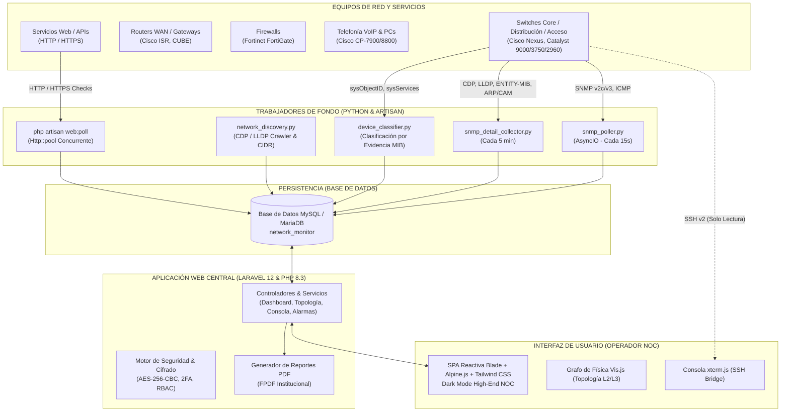
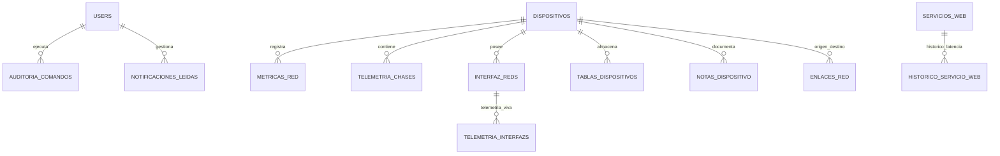

# DOCUMENTACIÓN TÉCNICA Y MANUAL DE OPERACIÓN
## PLATAFORMA ENTERPRISE DE MONITOREO Y TELEMETRÍA DE RED (NOC)

---

| **Documento** | Manual Técnico, Arquitectura y Guía de Operación |
| :--- | :--- |
| **Plataforma** | Network Monitor NOC Enterprise Infrastructure Platform |
| **Versión** | 2.5 (Edición Producción Enterprise) |
| **Audiencia** | Directores de TI, Ingenieros de Red / SysAdmins, Operadores de NOC, Auditores y Clientes Finales |
| **Fecha de Emisión** | Octubre 2026 |
| **Clasificación** | Confidencial / Uso Oficial e Institucional |

---

## 1. RESUMEN EJECUTIVO Y ALCANCE

**Network Monitor NOC** es una plataforma integral de alta disponibilidad diseñada específicamente para Centros de Operaciones de Red (NOC) de nivel gubernamental y corporativo. Su objetivo es centralizar en una única interfaz web interactiva la supervisión en tiempo real, el diagnóstico inteligente de fallas, la auditoría de seguridad y la telemetría continua tanto de la **infraestructura física de red (L2/L3)** como de los **servicios web y transaccionales críticos**.

### 1.1 Objetivos de Negocio y Operación
* **Visibilidad de Extremo a Extremo:** Monitorear conmutadores Core, routers de borde WAN, switches de acceso y distribución, firewalls perimetrales, telefonía IP (VoIP), access points inalámbricos y servidores.
* **Reducción del MTTR (Mean Time to Repair):** Detección instantánea de enlaces caídos, saturación de interfaces, errores CRC/descartes, degradación de latencia o pérdida de paquetes mediante un motor de diagnóstico inteligente con análisis de causa raíz.
* **Vigilancia de Servicios Críticos:** Supervisión constante de portales ciudadanos, plataformas de recaudación, pasarelas bancarias y servicios HTTP/HTTPS internos con sondeos concurrentes y alertas por degradación de tiempo de respuesta.
* **Gobierno y Seguridad:** Acceso restringido por roles (RBAC), autenticación en dos factores (2FA), passkeys, cifrado de credenciales SSH mediante AES-256 y auditoría forense de comandos de solo lectura ejecutados en consola.

---

## 2. ARQUITECTURA DEL SISTEMA Y STACK TECNOLÓGICO

La plataforma adopta un modelo híbrido de alto rendimiento que combina un **backend transaccional y reactivo en Laravel 12** con un **conjunto de trabajadores asíncronos especializados en Python 3.12**, diseñados para realizar sondeos concurrentes sin bloquear la experiencia de usuario.



### 2.1 Especificaciones Técnicas por Capa

| Capa | Tecnologías | Rol y Responsabilidad |
| :--- | :--- | :--- |
| **Backend Web** | PHP 8.3+, Laravel 12.x, Eloquent ORM, Fortify | Lógica de negocio, APIs REST/JSON, autenticación 2FA, gestión de roles y renderizado de vistas. |
| **Workers de Red** | Python 3.12+, AsyncIO, PySNMP, Ping3 | Sondeo de telemetría de ultra baja latencia, recolección de chasis, barrido de tablas ARP/CAM y descubrimiento. |
| **Frontend** | HTML5 semántico, Tailwind CSS, Alpine.js | Interfaz de operador NOC con soporte para tema Claro y Oscuro de alto contraste, animaciones Lottie y marquee continuo. |
| **Visualización** | Vis.js Network Engine, Chart.js, xterm.js | Renderizado del mapa de topología con física de resortes, gráficas de telemetría en tiempo real y terminal CLI. |
| **Base de Datos** | MySQL 8.0 / MariaDB 10.11+ | Almacenamiento estructurado de dispositivos, interfaces, métricas históricas, topología y registros de auditoría. |
| **Reportes** | FPDF con plantilla institucional oficial | Exportación ejecutiva en PDF de inventarios generales y hojas de especificación técnica individual. |

---

## 3. MÓDULOS DEL SISTEMA Y CAPACIDADES FUNCIONALES

### 3.1 Centro de Mando (NOC Dashboard)
El panel principal ofrece una visión panorámica y condensada de toda la infraestructura institucional:
* **Tarjetas KPI Globales:**
  * Total de equipos, conteo de equipos *En Línea*, en *Advertencia* y *Caídos*.
  * Utilización media global de CPU (%), memoria RAM (%) y temperatura del chasis (°C).
  * Latencia de red promedio (ms), porcentaje de pérdida de paquetes y saturación global de enlaces.
  * Uptime mínimo del sistema y conteo de errores de interfaz en el ciclo activo.
* **Series Temporales Interactivas:** Gráficas actualizadas periódicamente que trazan la evolución de latencia, tráfico en Mbps y pérdida de paquetes.
* **Inventario Dinámico de Dispositivos:** Tabla interactiva con búsqueda por texto, filtrado por categoría (Switches, Routers, Firewalls, Telefonía IP, Servidores, etc.) y acceso rápido a la ficha técnica de cada equipo.
* **Banner NOC LIVE Marquee:** Cinta animada superior que despliega diagnósticos en vivo de alarmas activas y enlaces en degradación.

### 3.2 Mapa de Topología Dinámica e Interactiva (L2 / L3)
Permite visualizar la estructura física y lógica de la red con un motor de física avanzado (Vis.js):
* **Renderizado de Hardware:** Identificación visual de cada categoría con iconografía vectorial dedicada (Cisco Nexus, Switches Core/Distribución, Routers Edge, Firewalls Fortinet, Teléfonos IP, Access Points y Servidores).
* **Enlaces Troncales y de Acceso:** Líneas de conexión que reflejan en tiempo real el estado operacional (verde = UP, rojo = DOWN, ámbar = advertencia) y el porcentaje de saturación de ancho de banda (1G, 10G, 40G, 100G).
* **Zonas Lógicas y Geográficas:** Posibilidad de crear recuadros visuales agrupando equipos por piso, edificio, site o rangos de subred IP (CIDR).
* **Persistencia de Coordenadas:** Los operadores con rol autorizado pueden mover los nodos y guardar las posiciones personalizadas para mantener un diagrama ordenado.
* **Vinculación Inteligente VoIP Pass-Through:** Algoritmo que detecta automáticamente teléfonos IP Cisco y resuelve qué computadora de escritorio está conectada a su puerto secundario mediante correlación de tablas CAM y ARP.
* **Notas de Dispositivo Cifradas:** Bitácora operativa por equipo para documentar números de ticket, racks, ubicaciones físicas o fechas de mantenimiento.

### 3.3 Monitoreo de Servicios y Páginas Web
Supervisa la disponibilidad de la capa de aplicación externa e interna:
* **Verificación de Endpoints HTTP/HTTPS:** Soporte para métodos `GET` y `HEAD` con tolerancia a certificados autofirmados o redirecciones internas.
* **Telemetría de Latencia Precisa:** Medición independiente del tiempo de transferencia (`transferStats`) para cada URL sondeada.
* **Clasificación Automática de Salud:**
  * **Online (Verde):** Código HTTP 2xx/3xx con tiempo de respuesta inferior a 3,500 ms.
  * **Advertencia (Ámbar):** Respuestas lentas (> 3.5 s) o errores de cliente HTTP 4xx (acceso restringido, no encontrado).
  * **Caído / Offline (Rojo):** Errores de servidor HTTP 5xx, timeouts de conexión o rechazo de conexión TCP.
* **Verificación Concurrente Masiva:** Capacidad de comprobar todas las URLs en paralelo mediante `Http::pool` en pocos segundos.
* **Depuración Automática:** El sistema conserva el histórico detallado durante 7 días y purga registros antiguos para mantener un rendimiento óptimo de la base de datos.

### 3.4 Consola Segura CLI & Terminal Web
Puente de gestión para que los administradores e ingenieros de red puedan inspeccionar switches y routers directamente desde el navegador:
* **Terminal xterm.js Completa:** Soporte para colores ANSI, historial de comandos, atajos de teclado y redimensionamiento de pantalla.
* **Conexión SSH v2 Segura:** Conexión directa mediante llaves o contraseñas cifradas en base de datos.
* **Política Estricta de Solo Lectura (Read-Only Guard):**
  * Se prohíben comandos de modificación o reinicio (`configure terminal`, `reload`, `write erase`, `shutdown`, `delete`, etc.).
  * Lista blanca de comandos de diagnóstico permitidos (`show `, `get `, `ping `, `traceroute `, `diagnose sys session stat`).
* **Auditoría Forense Integral:** Cada comando ejecutado queda registrado en la tabla `auditoria_comandos` con usuario, IP origen, dispositivo destino, timestamp exacto y salida obtenida.

### 3.5 Ficha Técnica Detallada de Dispositivo (Datasheet & Faceplate)
Vista profunda individual para cada conmutador o router registrado:
* **Ficha Técnica Oficial del Fabricante:** Modelo comercial, número de parte, procesador, arquitectura, versión de sistema operativo (IOS / NX-OS / FortiOS) y número de serie del chasis.
* **Faceplate Físico de Puertos:** Representación visual del panel frontal del switch, donde cada puerto se colorea según su estado real (Verde = Conectado, Gris = Down, Rojo = ErrDisabled, Rayo = PoE Activo) y muestra información de duplex, velocidad y VLAN al posicionar el cursor.
* **Cuatro Pestañas de Especialidad:**
  1. *Ficha Técnica & Hardware:* Información de módulos, fuentes de poder redundantes, memoria y sensores de temperatura.
  2. *Direccionamiento y Descubrimiento:* Direcciones IP/IPv6, tabla ARP y vecinos descubiertos por CDP/LLDP.
  3. *L2 / Switching & STP:* Tabla de direcciones MAC (CAM), estado de Spanning Tree Protocol (Root Bridge, bloqueos) y VLANs creadas.
  4. *Seguridad, QoS y Multicast:* Control de tormentas, inspección DHCP, tablas de enrutamiento y colas de calidad de servicio.
* **Exportación en PDF:** Descarga con un solo clic de la ficha técnica institucional en formato PDF para adjuntar a expedientes de mantenimiento.

### 3.6 Motor de Diagnóstico Inteligente de Fallas
El servicio `AlarmDiagnosisService` analiza continuamente la telemetría agregada para evitar falsas alarmas y cascadas de notificaciones:
* Si un switch de distribución o Core cae, el sistema diagnostica la causa raíz y marca los equipos dependientes como inalcanzables por enlace de subida, en lugar de generar decenas de alarmas individuales.
* Centro de notificaciones con botón de marcado como leída o descarte por usuario.

---

## 4. ESQUEMA DE BASE DE DATOS Y MODELADO DE DATOS

El esquema relacional está diseñado para soportar altos volúmenes de telemetría y consultas concurrentes.



### 4.1 Diccionario de Tablas Principales

| Tabla | Propósito y Contenido |
| :--- | :--- |
| `dispositivos` | Catálogo de activos de red (nombre, IP, tipo, modelo, fabricante, comunidad SNMP, credenciales SSH cifradas, estado online/offline/warning). |
| `metricas_red` | Métricas operativas por ciclo de sondeo (CPU, memoria, temperatura, ping, pérdida de paquetes, errores CRC). |
| `telemetria_chases` | Datos estáticos y de inventario físico (número de serie, firmware, modelo exacto ENTITY-MIB, uptime en segundos y formateado). |
| `interfaz_reds` | Inventario de puertos físicos y lógicos (índice MIB, nombre normalizado, alias/descripción, velocidad nominal, tipo físico). |
| `telemetria_interfazs` | Métricas operativas por puerto (estado operacional up/down, bytes in/out, paquetes unicast/multicast, errores y estado PoE). |
| `enlaces_red` | Topología de interconexión entre puertos de origen y destino, detectada por CDP/LLDP o registrada manualmente. |
| `tablas_dispositivos` | Captura serializada en formato JSON de las tablas CAM (MACs aprendidas), tablas ARP (IP vs MAC) y catálogo de VLANs. |
| `servicios_web` | Catálogo de sitios y endpoints HTTP/HTTPS monitoreados con su estado actual, último código HTTP y latencia en ms. |
| `historico_servicio_web` | Registro cronológico de disponibilidad y latencia de los servicios web para análisis histórico. |
| `auditoria_comandos` | Bitácora de seguridad con el registro de cada comando ejecutado en consola SSH, con ID de usuario, IP y resultado. |
| `configuraciones_generales` | Parámetros globales del NOC (intervalo de sondeo en segundos, comunidad SNMP por defecto, IP del Core, umbrales de alerta). |
| `zonas_topologia` | Delimitaciones lógicas y geográficas en el plano de red con coordenadas y rangos IP asociados. |

---

## 5. MECANISMOS DE SEGURIDAD Y CONTROL DE ACCESO

### 5.1 Control de Acceso Basado en Roles (RBAC)
La plataforma implementa tres niveles de privilegios estrictamente controlados mediante middleware de Laravel:
1. **Administrador (`Admin`):**
   * Acceso total al sistema.
   * Gestión y creación de usuarios y roles.
   * Configuración de umbrales del motor SNMP e IP del switch Core.
   * Guardado de credenciales SSH de los equipos de red.
   * Ejecución de descubrimientos de red y escaneos de subred.
2. **Operador (`Operador`):**
   * Consulta completa del Dashboard, Topología, Fichas de Switches y Servicios Web.
   * Ejecución de diagnósticos en consola CLI segura (comandos permitidos de solo lectura).
   * Verificación manual de servicios web y sondeo bajo demanda.
   * Organización y guardado de coordenadas en el mapa de topología.
3. **Auditor (`Auditor`):**
   * Acceso de solo lectura a métricas, inventario y registros de auditoría.
   * Generación y descarga de reportes ejecutivos en PDF.
   * Sin permisos para ejecutar comandos CLI o modificar configuraciones.

### 5.2 Cifrado de Credenciales y Llaves
* Las contraseñas de acceso SSH de los dispositivos de red se almacenan en la columna `ssh_password_encrypted` mediante la fachada `Crypt::encryptString()` de Laravel, utilizando el algoritmo estándar **AES-256-CBC** respaldado por la llave maestra `APP_KEY` del archivo `.env`.
* Las contraseñas de usuario se almacenan con el algoritmo de hash seguro **Bcrypt** con factor de costo 12.

### 5.3 Autenticación de Dos Factores (2FA) y Passkeys
* La plataforma integra autenticación multifactor basada en tiempo (TOTP) compatible con aplicaciones estándar de la industria (Google Authenticator, Microsoft Authenticator, Authy).
* Protección con contraseña reforzada para áreas críticas como el módulo de Ajustes Generales.

---

## 6. PROCESOS DE FONDO Y AUTOMATIZACIÓN (WORKERS)

Para garantizar un monitoreo ininterrumpido sin degradar la respuesta del servidor web, el sistema cuenta con un ecosistema de trabajadores independientes:

### 6.1 Catálogo de Workers

| Proceso | Archivo / Comando | Frecuencia | Función Operativa |
| :--- | :--- | :--- | :--- |
| **Sondeo SNMP en Vivo** | `worker/snmp_poller.py` | Cada 15 seg. | Barrido asíncrono con AsyncIO de todos los dispositivos activos: ping ICMP, uso de CPU, uso de RAM, estado operacional de interfaces y cálculo de tráfico en Mbps. |
| **Colector de Chasis** | `worker/snmp_detail_collector.py` | Cada 5 min. | Sondeo profundo de chasis: serial, versión de software, tablas CAM de direcciones MAC, tablas ARP y estado de fuentes de poder. |
| **Monitoreo Web** | `php artisan web:poll` | Cada 15 seg. | Peticiones HTTP concurrentes a los 23 servicios web registrados para medir latencia y código de estado. |
| **Clasificador por Evidencia** | `worker/device_classifier.py` | Cada 1 hora | Inspección de MIBs estándar (`sysObjectID`, `ENTITY-MIB`, `sysServices`) para clasificar de forma fidedigna el tipo exacto de cada equipo. |
| **Descubrimiento de Red** | `worker/network_discovery.py` | Bajo demanda | Algoritmo tipo crawler que inicia en el switch Core y rastrea enlaces vecinos mediante tablas CDP y LLDP. |

### 6.2 Orquestador de Inicio Rápido (`iniciar_monitor.bat`)
El archivo ejecutable incluido en la raíz del proyecto automatiza el arranque integral del entorno en servidores Windows:
1. `[0/5]` Limpieza y optimización de cachés (`php artisan optimize:clear`).
2. `[1/5]` Servidor Web Laravel en modo local (`php artisan serve --host=0.0.0.0 --port=8000`).
3. `[2/5]` Worker de Sondeo SNMP en vivo en ventana independiente.
4. `[3/5]` Worker de Colector Detallado en ventana independiente.
5. `[4/5]` Bucle de monitoreo continuo de Servicios Web.
6. `[5/5]` Clasificador periódico de activos por evidencia.

---

## 7. MANUAL DE INSTALACIÓN Y PUESTA EN MARCHA

### 7.1 Requisitos del Sistema
* **Sistema Operativo:** Windows Server 2019/2022 o Windows 10/11 Pro (también compatible con distribuciones Linux Ubuntu/Debian/RHEL).
* **Entorno Web:** PHP 8.3 o superior (extensiones obligatorias: `pdo_mysql`, `mbstring`, `openssl`, `curl`, `snmp`, `gd`, `fileinfo`).
* **Gestor de Paquetes PHP:** Composer 2.7+.
* **Motor de Base de Datos:** MySQL 8.0+ o MariaDB 10.5+ (puerto por defecto: 3306).
* **Entorno de Red / Workers:** Python 3.12+ (con paquetes `mysql-connector-python`, `pysnmp`, `ping3`, `python-dotenv`).
* **Entorno Frontend:** Node.js 18+ y NPM (para compilación de estilos con Vite).

### 7.2 Procedimiento de Instalación Paso a Paso

#### Paso 1: Clonación del Código y Preparación de Carpetas
```bash
cd c:\MAMP\htdocs
git clone https://github.com/2125200128-cloud/network-monitor.git
cd network-monitor
```

#### Paso 2: Instalación de Dependencias de Backend y Frontend
```bash
# Dependencias PHP de Laravel
composer install --no-dev --optimize-autoloader

# Dependencias JavaScript y compilación de producción de Vite
npm install
npm run build
```

#### Paso 3: Instalación de Dependencias de Python
```bash
python -m pip install -r worker/requirements.txt
```

#### Paso 4: Configuración del Archivo de Entorno (`.env`)
Crear el archivo `.env` tomando como base `.env.example` y ajustar los parámetros institucionales:
```ini
APP_NAME="Network Monitor NOC"
APP_ENV=production
APP_DEBUG=false
APP_URL=http://10.4.25.191:8000

DB_CONNECTION=mysql
DB_HOST=127.0.0.1
DB_PORT=3306
DB_DATABASE=network_monitor
DB_USERNAME=root
DB_PASSWORD=TuPasswordSeguro

# Parámetros del motor de red
SNMP_COMMUNITY=monitorsefin
IP_SWITCH_CORE=10.4.254.3
```

Generar la llave de cifrado de la aplicación:
```bash
php artisan key:generate
```

#### Paso 5: Estructura de Base de Datos y Cuentas Iniciales
```bash
php artisan migrate --force
php artisan db:seed --class=UserSeeder
```

#### Paso 6: Puesta en Producción
Hacer doble clic en `iniciar_monitor.bat` o configurar los comandos como Servicios de Windows con **NSSM (Non-Sucking Service Manager)** para arranque desatendido al iniciar el servidor.

---

## 8. GUÍA DE OPERACIÓN PARA EL CLIENTE Y EL EQUIPO NOC

### 8.1 Acceso al Sistema
1. Abrir un navegador moderno (Google Chrome, Microsoft Edge, Mozilla Firefox).
2. Ingresar a la URL asignada del servidor: `http://<IP_DEL_SERVIDOR>:8000`.
3. Iniciar sesión con las credenciales asignadas por el Administrador.
4. Si tiene 2FA configurado, ingresar el código de 6 dígitos generado en su aplicación de autenticación.

### 8.2 ¿Cómo Monitorear un Nuevo Switch o Router?
1. En el menú lateral izquierdo, hacer clic en el botón **Agregar** (icono de círculo con el símbolo `+`).
2. Ingresar los datos del equipo:
   * **Nombre:** Nombre canónico del equipo (ej. `SW-ACC-PISO3`).
   * **Dirección IP de Gestión:** IP alcanzable por SNMP (ej. `10.4.254.45`).
   * **Comunidad SNMP:** Si difiere de la general, especificarla.
   * **Tipo de Dispositivo:** Switch, Router, Firewall, etc.
3. Hacer clic en **Guardar Dispositivo**. El worker `snmp_poller.py` comenzará a recopilar métricas inmediatamente en el siguiente ciclo (menos de 15 segundos).

### 8.3 ¿Cómo Monitorear un Nuevo Servicio Web?
1. En el menú lateral, seleccionar la pestaña **Webs** (icono de globo terráqueo).
2. Hacer clic en el botón **Agregar Sitio**.
3. Completar el formulario:
   * **Nombre del Sitio:** Nombre descriptivo (ej. `Portal de Pagos Estatal`).
   * **URL Completa:** Incluir protocolo (ej. `https://pagos.hacienda.gob.mx`).
   * **Categoría:** Trámites, Sefin, Bancos, Multipagos, Gobierno o Internos.
   * **Método HTTP:** `GET` (recomendado) o `HEAD`.
4. Hacer clic en **Guardar Sitio**. La plataforma realizará una comprobación inmediata de latencia y código HTTP.

### 8.4 ¿Cómo Utilizar la Consola Segura CLI?
1. Ingresar a la pestaña **CLI** (icono de terminal de comandos).
2. En el panel superior, seleccionar el switch o router a diagnosticar del menú desplegable.
3. Si el equipo no tiene credenciales guardadas, hacer clic en el botón de ajustes para ingresar el usuario y contraseña SSH (las credenciales se cifran automáticamente).
4. Escribir comandos de solo lectura en la barra inferior (ejemplo: `show ip interface brief`, `show version`, `show cdp neighbors`, `ping 8.8.8.8`) y presionar Enter.
5. El resultado se renderizará de forma instantánea en la ventana de terminal y la acción quedará registrada en el historial de auditoría visible a la derecha.

### 8.5 Generación y Descarga de Reportes PDF
* **Inventario Ejecutivo Completo:** En el Dashboard principal, hacer clic en el botón superior derecho **Reporte PDF**. El sistema generará en tiempo real un informe oficial institucional con el resumen de métricas globales y el listado de todos los equipos con su modelo, uptime y estado.
* **Ficha Técnica de Switch Individual:** Ingresar al detalle de cualquier switch y hacer clic en el botón de **Descargar Ficha Técnica PDF**.

---

## 9. MANTENIMIENTO, RESPALDOS Y RESOLUCIÓN DE PROBLEMAS

### 9.1 Respaldo Periódico de la Base de Datos
Se recomienda programar una tarea diaria automatizada con `mysqldump`:
```bash
# Comando de respaldo manual:
mysqldump -u root -p network_monitor > backup_noc_%date:~-4,4%%date:~-7,2%%date:~-10,2%.sql
```

### 9.2 Preguntas Frecuentes y Diagnóstico de Incidencias

#### A. Un equipo aparece con estado "Offline" constantemente
* Verificar si el equipo responde a ping ICMP desde la consola del servidor: `ping <IP_DEL_EQUIPO>`.
* Comprobar que el servicio SNMP esté habilitado en el equipo físico y que la lista de control de acceso (ACL) permita la IP del servidor NOC.
* En Cisco IOS: `show run | include snmp-server`. Asegurar que la comunidad configurada coincida con la registrada en la plataforma.

#### B. La Consola Segura CLI rechaza un comando
* La consola cuenta con un filtro estricto de seguridad. Los comandos de configuración o que alteren el servicio están deliberadamente bloqueados para proteger la red. Solo se permiten comandos de diagnóstico y consulta que comiencen con `show`, `get`, `ping`, `traceroute` o `diagnose`.

#### C. Las métricas del Dashboard no se actualizan
* Verificar que la ventana del worker `NOC - SNMP Poller` (`worker/snmp_poller.py`) esté en ejecución y no haya sido cerrada.
* Si el servicio se detuvo, ejecutar nuevamente `iniciar_monitor.bat`.

---

## 10. CERTIFICACIÓN DE ENTREGA AL CLIENTE

El presente sistema ha sido verificado y auditado en sus componentes de software, base de datos y diseño de interfaz gráfica, cumpliendo con los estándares de rendimiento, disponibilidad y seguridad requeridos para operaciones en centros de control de infraestructura crítica.

* **Estado de la Solución:** Producción / Operacional
* **Monitoreo Activo:** Red L2/L3, Telefonía IP y Servicios Web
* **Documentación Entregada:** Manual Técnico, Código Fuente y Esquemas de Base de Datos
